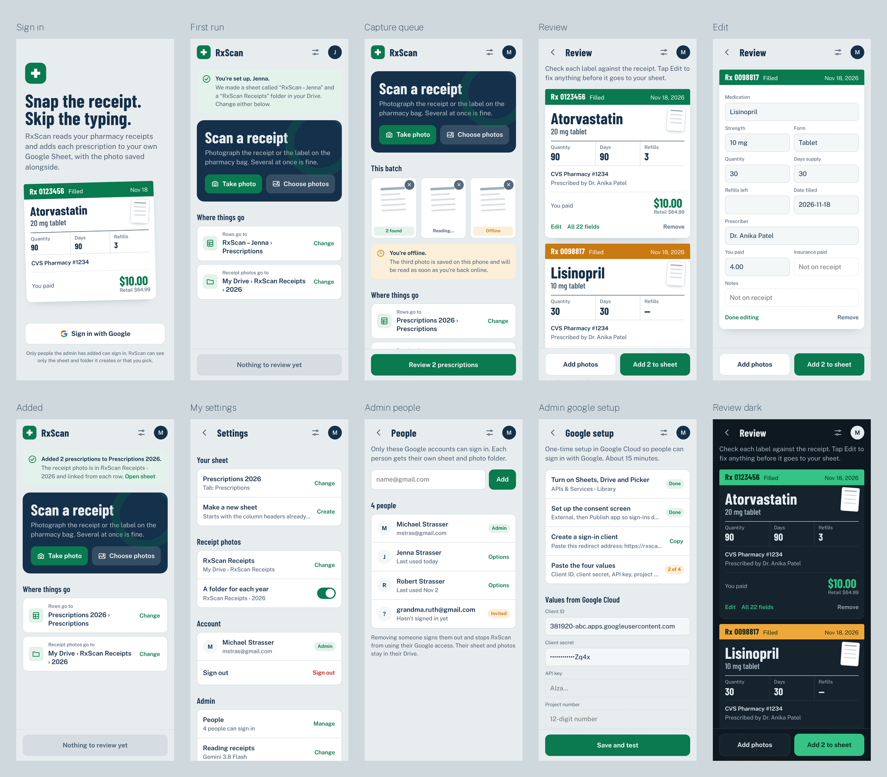
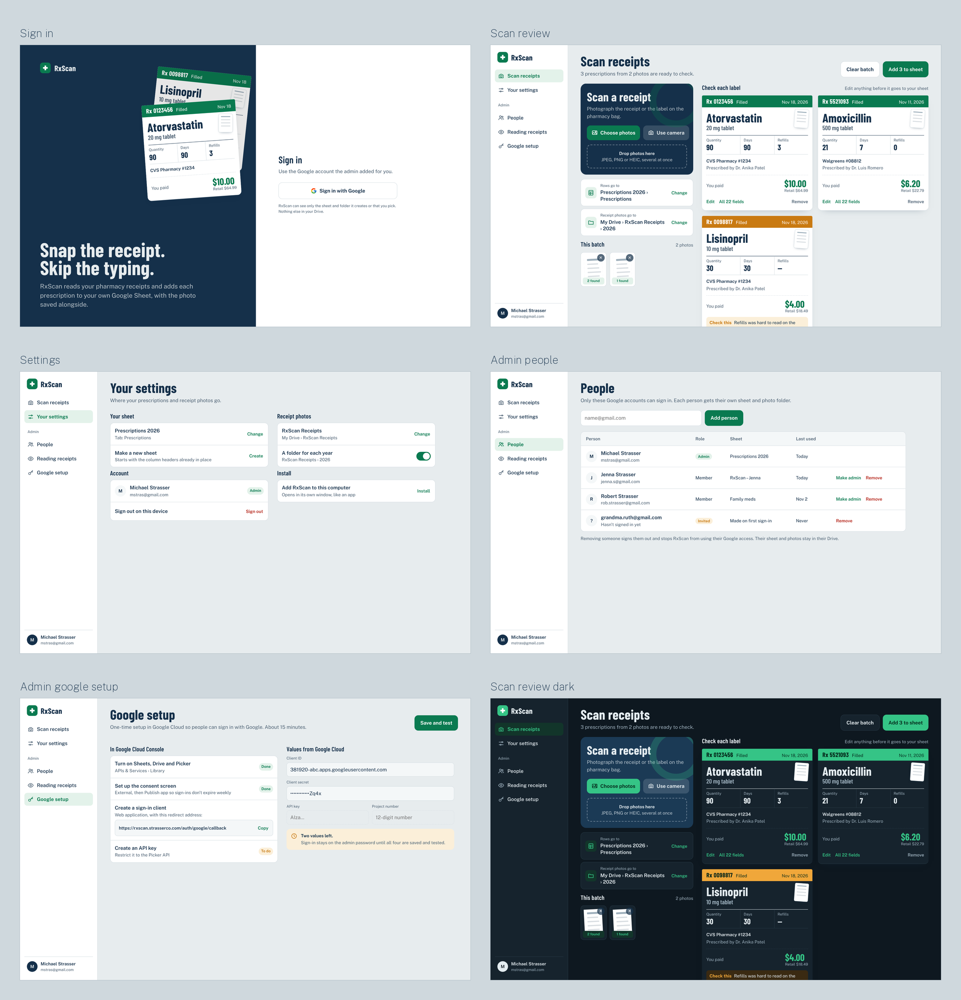

# RxScan

[](https://github.com/mstras/rxscan/actions/workflows/docker.yml)

Photograph a pharmacy receipt or Rx bag label. A vision model reads each prescription into 22 columns, you check it on a pharmacy-label card, and it's added to **your own** Google Sheet, with the receipt photo saved to **your own** Drive folder and linked from the row.

Each person signs in with Google and gets their own sheet and folder. You choose who can sign in.

| Phone | Web |
|---|---|
|  |  |

- **Per-person:** each person signs in with Google. On first sign-in RxScan creates their sheet ("RxScan – Name", headers in bold) and a "RxScan Receipts" folder, or they pick existing ones with the Google file picker.
- **Least access:** RxScan uses Google's `drive.file` permission, so it can only reach the sheet and folder it created or that the person picked. Nothing else in their Drive.
- **Admin controls:** People (who can sign in, who is admin), how receipts are read (model and key), and Google setup. Members only change their own sheet and folder.
- **Review that's quick to scan:** each prescription is shown as an Rx label. Fields the model couldn't read clearly turn the label amber and say which ones to check.
- **Installable app (PWA):** works offline, queues photos taken without signal, keeps drafts if the app is closed, and accepts photos from the Android share sheet. On a computer, drag photos onto the page.

## Quick start
```bash
mkdir -p /mnt/two/Containers/rxscan && cd /mnt/two/Containers/rxscan
curl -fsSLO https://raw.githubusercontent.com/mstras/rxscan/main/docker-compose.yml
docker compose up -d          # http://homeserv:8096
```
1. Sign in with the built-in admin password (**admin / admin123**; set `APP_USERNAME`/`APP_PASSWORD` in `.env` to change it).
2. **Reading receipts:** paste a Gemini API key (or Claude, or point at Ollama).
3. **Google setup:** follow the checklist below (about 15 minutes, once).
4. **People:** add your own Gmail as admin, plus anyone else. Sign out and **Sign in with Google**.

`./data` holds the user database, encrypted Google tokens, settings and keys. Back it up. Its permissions are fixed automatically (`PUID`/`PGID` in the compose file).

## Google setup (one time)
Google requires an **https** address, so do this through your Pangolin URL (e.g. `https://rxscan.strasserco.com`). The Google setup page in RxScan shows the exact addresses to paste.

1. **Create a project** at console.cloud.google.com. In **APIs & Services → Library**, enable **Google Sheets API**, **Google Drive API** and **Google Picker API**.
2. **Consent screen** (Google Auth platform): Branding: app name "RxScan" and your email. Audience: **External**. Data access: add the scope `.../auth/drive.file`. Then click **Publish app**. While it says *Testing*, Google expires everyone's access every 7 days. `drive.file` is a non-sensitive scope, so publishing doesn't need Google's review.
3. **Client:** Clients → Create client → **Web application**. Authorized JavaScript origin: `https://rxscan.strasserco.com`. Authorized redirect URI: `https://rxscan.strasserco.com/auth/google/callback`.
4. **API key:** APIs & Services → Credentials → Create credentials → API key. Restrict it to the **Google Picker API** and your RxScan address (HTTP referrer).
5. In RxScan → **Google setup**, paste the **client ID**, **client secret**, **API key** and **project number** (on the project dashboard), then **Save and test**.

You can also set these in `.env` (`GOOGLE_CLIENT_ID`, `GOOGLE_CLIENT_SECRET`, `GOOGLE_API_KEY`, `GOOGLE_PROJECT_NUMBER`), and pre-approve admins with `ADMIN_EMAILS=you@gmail.com`.

**Work Google accounts:** a Workspace admin may block third-party apps. Personal Gmail accounts work.

## Upgrading from 1.0
- Pull the new image and restart. Everyone is signed out once, because the sign-in cookie format changed.
- The admin password keeps working and still uses your 1.0 Apps Script connection, sheet and Drive folder (now under **Google setup → Older connection**). People who sign in with Google use their own sheet and folder instead.
- New settings live in `data/`; nothing in your existing `.env` needs to change.

## Install as an app
Open the https address. **iPhone:** Safari → Share → **Add to Home Screen**. **Android/desktop Chrome:** Settings → **Install**. The installed app keeps its own sign-in, so you sign in once more inside it.

## Columns
Date Filled, Patient, Medication, Strength, Form, Quantity, Days Supply, Refills Left, Rx Number, NDC, Prescriber, Pharmacy, Pharmacy Address, Pharmacy Phone, Insurance, Retail Price, Insurance Paid, Savings, You Paid, Payment Method, Transaction ID, Notes, Receipt (link to the photo), Source Image, Added At.

Edit `app/fields.py` to change them. If a sheet already has its own headers, values go under matching header names and a Receipt column is added if missing.

## Reading receipts
| Provider | Notes |
|---|---|
| Gemini (default) | `gemini-3.8-flash` recommended; `gemini-3.5-flash-lite` is cheaper. On the free tier Google may use requests to improve its products, so turn on billing for medical receipts. |
| Claude | `claude-sonnet-5-5`. Very accurate on crumpled thermal receipts. |
| Ollama | Fully local. Needs a vision model; slow and less accurate on a CPU-only server. |

Everyone shares the admin's key.

## Security
- Sign-in is required for everything except icons, scripts, the manifest and `/healthz`.
- Google sign-in only admits emails on the People list. Removing someone signs them out everywhere and revokes RxScan's Google access.
- Google refresh tokens are encrypted at rest (`data/secret.key`). Sessions are HMAC-signed (`data/session.key`) and last `SESSION_DAYS` (90).
- The admin password locks an IP out for 15 minutes after 8 wrong attempts. **Change admin123** if RxScan is reachable from the internet.
- Receipt photos are processed in memory; with Google sign-in they're stored only in the person's Drive.

## Configuration (.env, all optional)
See [.env.example](.env.example). Admin-only settings can also be changed in the app and are saved in `data/settings.json`.

## Development
- **Build from source:** `docker compose -f docker-compose.yml -f docker-compose.build.yml up -d --build`
- **CI:** pushing to `main` builds, smoke-tests, and publishes `linux/amd64` + `linux/arm64` to `ghcr.io/mstras/rxscan:latest`; a `vX.Y.Z` release publishes `:X.Y.Z` and `:X.Y`.
- **Design:** [docs/mockups](docs/mockups/README.md) has the mockups and the shared stylesheet (`app/static/rx.css`).

See [CHANGELOG.md](CHANGELOG.md).
