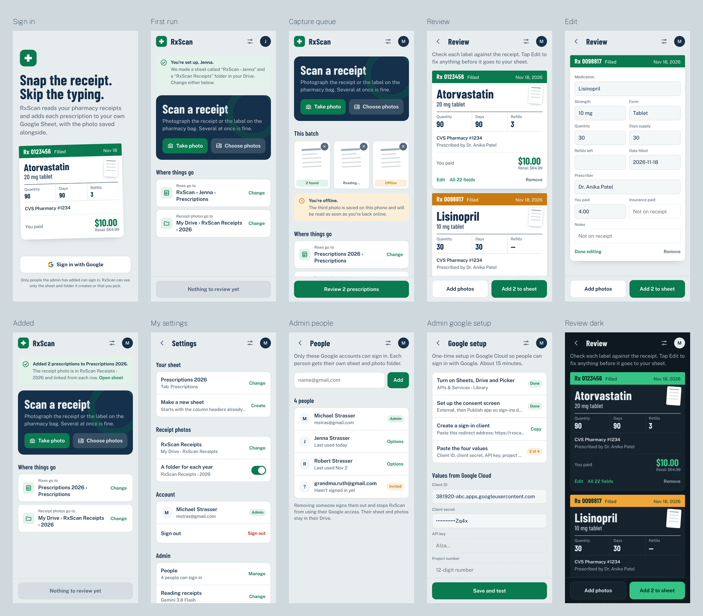
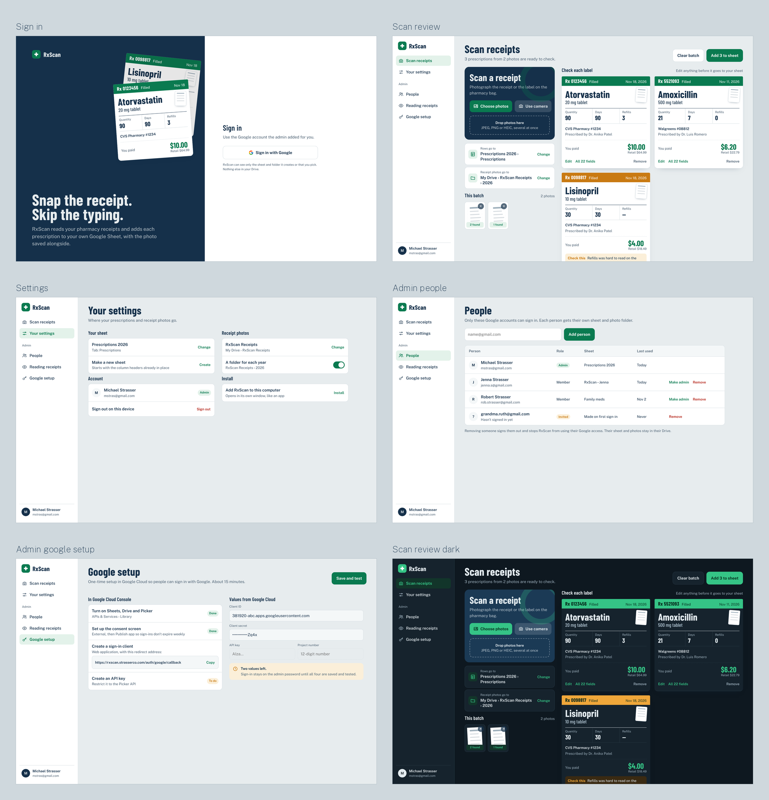

# RxScan 1.1: design mockups

These are the designs 1.1 was built from. The app's stylesheet (`app/static/rx.css`) started from `rx.css` here.

## Phone


## Web / desktop


## Direction
**The pharmacy bag label.** Each parsed prescription is shown as a crisp Rx label: a colored band with the Rx number and fill date, the drug name set large, and a ruled grid for quantity, days and refills. That label is the one loud element; everything around it stays quiet so the review step is fast to scan.

| Token | Value | Used for |
|---|---|---|
| Counter | `#E7ECEE` | Page background (pharmacy counter laminate) |
| Label | `#FFFFFF` | Cards and label stock |
| Ink | `#15304A` | Text, prescription-pad navy |
| Green | `#0A7A50` | Primary actions, the Rx band, the pharmacy-cross mark |
| Amber | `#C97A12` | Waiting / offline / "check this" states (pill-bottle amber) |

**Type:** Barlow Condensed (600/700) for drug names and titles, which reads like a label printer. Public Sans for everything else. Both are bundled in `app/static/fonts` (SIL OFL) so the installed app works offline.

**States carry meaning in color:** a label with a field the model couldn't read turns amber and says which field. Offline photos are amber, read photos are green.

## Screens
| # | Screen | What's new in 1.1 |
|---|---|---|
| 1 | Sign in | Sign in with Google replaces the username/password page |
| 2 | First run | A new person's sheet and photo folder are created automatically |
| 3 | Capture queue | Photo states (read, reading, offline) plus where rows and photos go |
| 4 | Review | Rx label cards; low-confidence fields flagged in amber |
| 5 | Edit | Inline editing on the label |
| 6 | Added | Confirmation with a link to the sheet |
| 7 | Your settings | Per-person sheet and folder; admin section only for admins |
| 8 | People (admin) | Allowlist of Google accounts who can sign in |
| 9 | Google setup (admin) | Guided one-time Google Cloud setup |
| 10 | Review, dark | Dark mode |

### Web / desktop (1440 × 900)
| Screen | Notes |
|---|---|
| Sign in | Split layout: the label motif on the navy panel, sign-in on the right |
| Scan and review | Sidebar navigation; the scan panel (with drag-and-drop) stays pinned on the left while labels flow in columns on the right; "Add to sheet" sits in the page header |
| Your settings | Two columns: sheet and account, photos and install |
| People (admin) | Table with role, sheet and last use; make admin or remove |
| Google setup (admin) | Checklist on the left, values on the right; copyable redirect address |
| Scan and review, dark | Dark mode |

Same tokens and components as the phone screens. The web layout switches on at 900 px wide.

## Regenerate
```bash
python3 docs/mockups/build.py     # writes screens/*.html from shared pieces
python3 docs/mockups/render.py    # renders png/*.png and overview.png (Playwright + Chrome)
```
